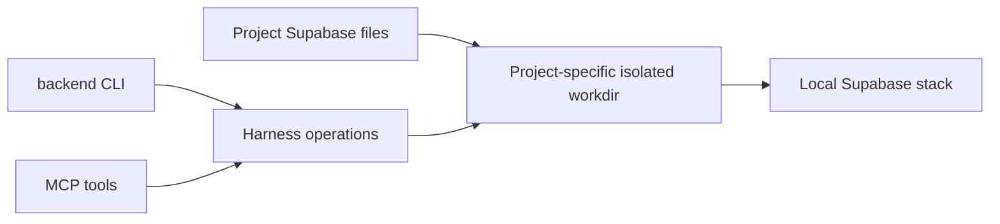
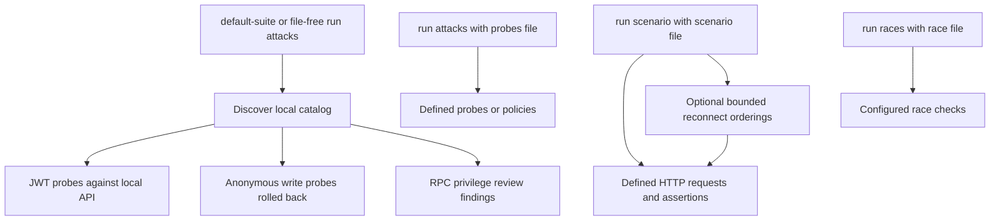
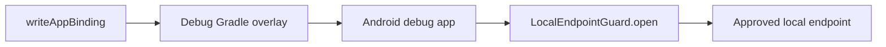

# supa-multiuser-harness

A local-only Supabase test harness. It provides migration and stack operations, local identity/JWT tooling, configurable HTTP authorization and race probes, bounded reconnect-order exploration, Android debug binding and a separately versioned Kotlin simulated-device library. See [IMPLEMENTATION_PLAN.md](IMPLEMENTATION_PLAN.md) for verification status.

## From source

Install Node.js 24, JDK 21, Android SDK platform-tools, PostgreSQL client tools (`psql` on PATH), Docker and Supabase CLI 2.75.0. On Windows, use Docker Desktop with WSL2 integration and keep project files on a filesystem accessible to Docker. From this repository, run `npm ci`, `npm run build`, then `node dist/cli/index.js doctor --json`. The sibling `../android-kit` repository supplies the schema package and must be built first.

To install the published commands, run `npm install -g @budaknyenyel/supa-multiuser-harness`. From a source checkout, run `npm link` after building to put `backend` and `backend-mcp` on PATH.

For the local `ak-harness` project, run `backend stack up --json`, `backend stack verify --json`, then `backend default-suite --json` (or `backend run attacks --json`). The default suite needs no probe file: it inspects exposed schemas, issues JWT probes against the verified local API, and checks anonymous writes in one rolled-back superuser transaction with `session_replication_role = replica` (ordinary triggers, including pg_net or webhook triggers, do not fire) and anon RLS applied. Tables with `ENABLE ALWAYS` triggers still fire in replica mode, so their write probes are reported `blocked` with the trigger names instead of run. Findings distinguish detected failures from review items; a pass does not establish cross-tenant isolation, all write authorization, RPC safety, or race correctness.

Each project uses `ak-harness-<project hash>` and a derived six-port block. Set `BACKEND_PORT_BASE` to choose another block if ports conflict. The workdir owner marker must match before destructive operations and probes.

The stack operations use an isolated workdir rather than starting the project's own Supabase directory:

Inconclusive checks do not fail the default suite by default; the summary calls them out and suggests seeding synthetic rows with a scenario. Use `backend default-suite --strict` or `backend run attacks --strict` to fail on inconclusive checks. MCP callers can pass `strict: true` to `backend_default_suite` or file-free `backend_run_attacks`. Tool failures remain errors and blocked probes remain blocked.

For application-specific checks, create a starter with `backend init-scenario --json` (or `backend init-scenario path/to/scenario.yaml --json`); it does not overwrite an existing file. Edit it for the local application's synthetic data and explicit expectations, then use `backend run attacks probes.yaml --json`, `backend run scenario scenario.yaml --json`, or `backend run races races.yaml --json` as appropriate. Keep credentials out of committed files. Do not use production data or a linked project. Commands accept `--project-root` and `--json`; exit codes are 0 for pass, 1 for fail/flaky, and 2 for blocked/unsupported/error.

The default suite discovers checks from the local catalog; scenario checks run the requests and assertions you define. An explicit attacks file can also supply probes or policies, and race checks use a separate options file.

`backend stack down` stops only the verified local project-specific harness stack. It refuses linked projects and other project IDs.

A generic MCP client can launch `node` with arguments `["dist/mcp/index.js"]` and this repository as its working directory. MCP tools use the `backend_` prefix and the same operation parameters as the CLI.
The MCP equivalents are `backend_default_suite`, `backend_init_scenario` (optional `file`), and `backend_run_attacks` (optional `file`). Launch the server in the intended project directory; embedded callers can fix `projectRoot` when creating tool definitions.

The package root exports `toolDefinitions()`, `configSection`, `configSectionSchema`, `supportedSchemaMajors`, `doctor()`, and `status()`. Importing it does not launch MCP. `backend_status` and `status()` report the local stack's running state, local endpoint ports, and applied migration count without changing the stack; linked projects and remote endpoints are refused. The result uses the standard result envelope.

The `harness-client` Gradle project is a separate Kotlin/JVM library. Use JDK 21 and its wrapper (`harness-client/gradlew`, or `harness-client\gradlew.bat` on Windows) to build it. Include it only in debug or test configurations and route every request through its local endpoint guard. Its simulated devices are not proof of Android app integration.

Generate an overlay with the library API `writeAppBinding(directory, localUrl, apiKey)`. Apply the returned `binding.gradle` to the Android app module and supply `-PHARNESS_BINDING_DIR=<directory>` to Gradle. The overlay configures debug only; it does not route the app's network client through the guard. Add `harness-client` to debug/test dependencies and explicitly call `LocalEndpointGuard.open` for the actual request. Keep the generated properties private.

The debug binding supplies configuration, while the app must explicitly guard its requests:

Only loopback hosts are allowed by default. The emulator aliases `10.0.2.2` and `10.0.3.2` can refer to non-local hosts outside an emulator: opt in only in a trusted emulator environment. Pass `true` as the fourth argument to `writeAppBinding` to enable the aliases in the binding and debug network configuration, and pass `allowEmulator = true` to `LocalEndpointGuard.open` for the actual client request. For guard integration checks, pass `true` as the third argument to `requireGuardIntegration` as well.

`scanApkDex` reports local and non-local URL candidates, not proven backend destinations. A clean scan cannot prove runtime safety; R8 and constructed strings can hide endpoints.

No telemetry is collected. See [SECURITY.md](SECURITY.md) and [CONTRIBUTING.md](CONTRIBUTING.md).
